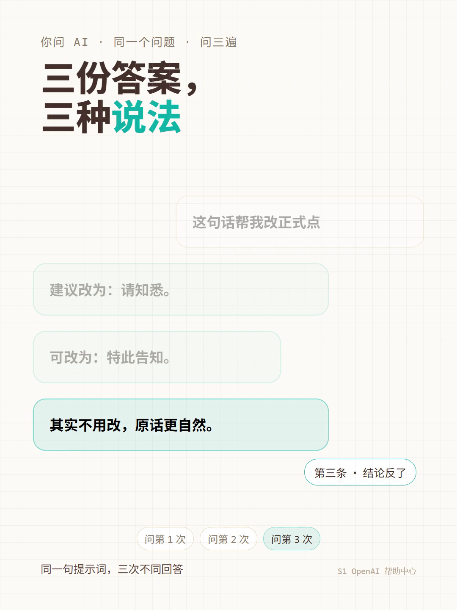
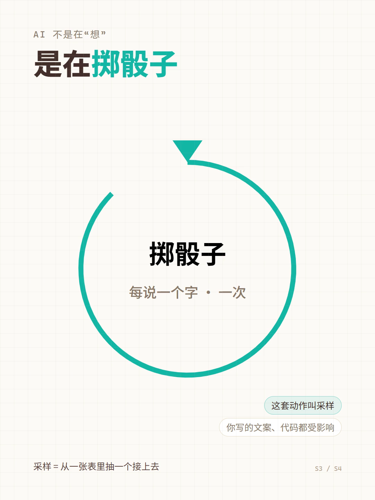
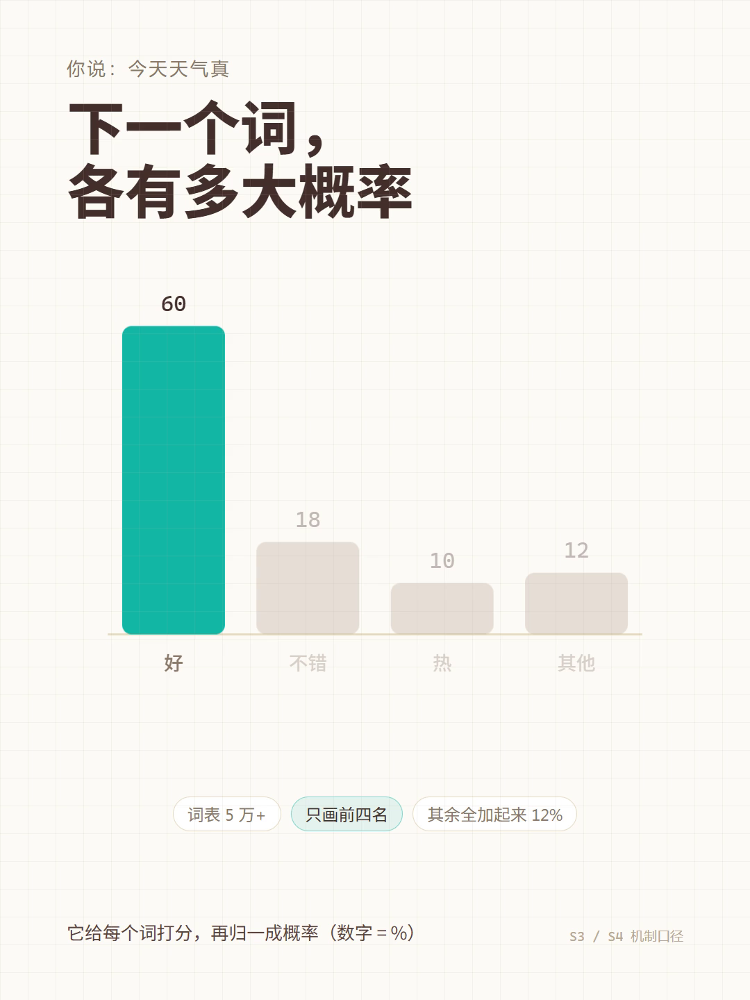
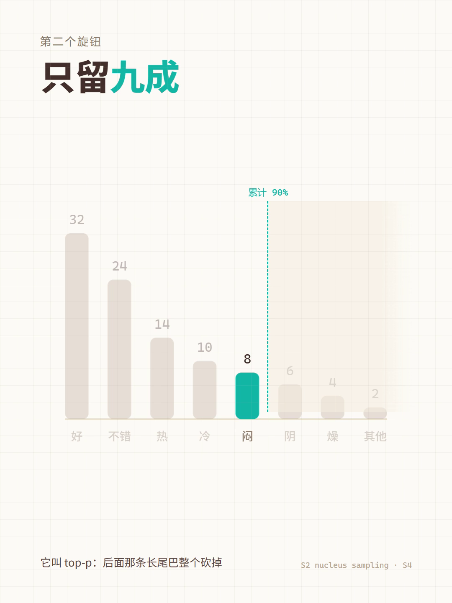

# xhs-video-agent

[English](README.md) | **中文版**

**把一篇文章变成一条可发布的小红书 3:4 短视频：调研 → 口播稿 → 网页演示 → 配音 → 录屏 → 三道闸门 → 发布 → T+3 天复盘。**

[](LICENSE)
[](#已知限制)
[](#环境依赖)

---

## 目录

- [1. 这是什么](#1-这是什么)
- [2. 示例成品](#2-示例成品)
- [3. 工作流总览](#3-工作流总览)
- [4. 快速开始](#4-快速开始)
- [5. cheat 校准回路](#5-cheat-校准回路)
- [6. 三道闸门](#6-三道闸门)
- [7. 可选：无人值守心跳](#7-可选无人值守心跳)
- [8. 目录结构](#8-目录结构)
- [9. 示例导览](#9-示例导览)
- [10. FAQ](#10-faq)
- [11. 已知限制](#11-已知限制)
- [12. 依赖与致谢](#12-依赖与致谢)
- [13. License](#13-license)

---

## 1. 这是什么

这是一套**给 AI agent 用的视频生产流水线**：agent 负责调研、写稿、写网页、配音、录屏；脚本负责机械校验；人只在三个硬节点做判断。

它不是"AI 一键生成视频"。它的核心是**把不可控的创作过程拆成可控工序**，每一步都有产物、有契约、有闸门。

### 适合谁

- 做知识 / 科普 / 产品解读类短视频，想要**稳定产出**而不是碰运气的人
- 已经用 Claude Code、CodeBuddy、Trae 等支持 skill 的 agent，愿意让 agent 写代码而不是只写文案的人
- 能接受"先写稿、再打分、再发布"这套慢流程，换取可复盘、可迭代的人
- Windows 用户（当前脚本以 PowerShell + Chrome 为主）

### 不适合谁

- 想要"输入标题、输出成片"的一键工具的人
- 纯口播、不想要网页动画的人（这套流程的画面是网页，不是素材剪辑）
- 完全不想碰命令行、Python、Node 的人
- 需要开箱即用的 SaaS 的人（这里没有服务器、没有账号系统）

---

## 2. 示例成品

示例片《同一个问题，AI 为什么每次答得不一样》成片 2 分 33 秒，13 拍，1080×1440 竖版。下面 5 张是从成片里按时间抽的帧（不是设计稿）：

| 0.6s · 钩子：三份答案 | 12s · 采样 = 掷骰子 |
|---|---|
|  |  |

| 30s · 下一个词的概率表 | 80s · top-p：只留九成 |
|---|---|
|  |  |

| 150s · 结尾回收钩子 |
|---|
|  |

> **首帧即封面。** 本流程从 2026-10-27 起不单独做封面图，平台取视频首帧作为信息流里的封面。因此第 1 拍必须自带大标题 + 钩子 + 一条能看懂的信息，而不是"欢迎来到我的频道"。`tools/cover/` 里的封面渲染工具仍然保留，需要时可用，但默认不进入交付清单。

完整的示例文本资产（调研卡 / 设计意图 / 口播稿 / 分镜大纲 / 自检）在 [`examples/ep11-sampling/`](examples/ep11-sampling/)，逐文件说明见 [`examples/README.md`](examples/README.md)。

---

## 3. 工作流总览

```
Phase 0  调研        article.md + 公网多源  →  facts.md（信源清单 + 关键数据 + 视觉比喻 + 教学设计）
   │                  ▲ 闸门：check.ps1 -Gate pre-script（facts 未定稿不许写稿）
Phase 1  文稿        facts.md → script.md（口播稿）+ outline.md（分镜大纲）+ beats.json
   │                  + design-intent.md（创作前三问）+ script-selfcheck.md（四层自检）
   │                  ▲ 闸门：check.ps1 -Gate pre-code（步数一致 / 开场三要素 / 时长估算）
   │                  ▲ 检查点 1：人一次对齐 6 件事（调研卡 / 稿子 / 大纲 / 主题 / 素材 / 开发模式）
Phase 2  网页开发    scaffold → 3:4 Vite+React 页面，逐章开发（第 1 章必须人工验收）
   │                  ▲ 检查点 2：第 1 章视觉 / 节奏 / AI 味验收
Phase 3  音频        extract-narrations → edge-tts 批量合成 → public/audio/
   │                  ▲ 检查点 3：是否合成音频
   │                  ▲ 闸门：check.ps1 -Gate pre-render（数量守恒 + 音频非空）
Phase 4  录屏        ?auto=1 一镜到底 → raw-vertical/video.webm + marks.json
   │                  → build_master.py 按实测切换时刻拼音频 → 成片 mp4
   │                  → verify_sync.py 音画同步互相关校验
   │                  ▲ 闸门：check.ps1 -Gate delivery
   │                  ▲ 目检：shots-review.ps1 逐拍抽帧
Phase 5  发布闸门    validate.ps1（9 项合规）+ 人工确认
Phase 6  发布        xiaohongshu-mcp publish_with_video（写操作，必须人工点确认）
Phase 7  复盘        T+3d pull.ps1 抓数据 → 预测 vs 实际 → 一行教训写回 docs/LESSONS.md
```

四份"外部记忆"文件决定了整条链路的质量，**不要跳过**：

| 文件 | 作用 | 谁写 |
|---|---|---|
| `facts.md` | 信源清单、关键数字（带出处）、抽象概念→视觉比喻、教学设计、论证链 | 调研阶段，agent + 人确认 |
| `script.md` | 口播稿，以 `---` 分拍；一拍 = 一屏 = 一段音频 | Phase 1，agent 写 + 人改 |
| `outline.md` | 章节 / 步数 / 每步画面元素 / 转场 / 阅读保护时长 | Phase 1，agent 写 + 人确认 |
| `beats.json` | 毫秒级节拍表（step_id / chapter / start_ms / dur_ms / text） | 定稿后生成，出片后以 `marks.json` 为准 |

**唯一真相源**：每章 `src/chapters/*/narrations.ts` 的数组长度 = 该章 step 数 = 音频文件数。改了 step 数，必须同步 bump `src/hooks/useStepper.ts` 里的 `STORAGE_KEY`，否则浏览器记住的游标会错位（详见 [docs/WORKFLOW.md](docs/WORKFLOW.md) §3）。

---

## 4. 快速开始

下面假设你在一台干净的 Windows 10/11 上，从零跑通第一条竖版视频。

### 4.1 环境依赖

| 组件 | 要求 | 验证命令 |
|---|---|---|
| 操作系统 | Windows 10/11（PowerShell 5.1） | `$PSVersionTable.PSVersion` |
| Node.js | ≥ 18，**Windows 原生版**，不要用 WSL 里的 node | `node -v` / `npm -v` |
| Python | ≥ 3.10 | `python --version` |
| Git for Windows | 需要它自带的 **Git Bash** 执行 `scaffold.sh` | `git --version` / `bash --version` |
| Google Chrome | Playwright 直接驱动本机 Chrome（不下载 Chromium） | `"C:\Program Files\Google\Chrome\Application\chrome.exe"` 存在 |
| ffmpeg | 可独立安装；也可用 `tools/record` 里的 `@ffmpeg-installer` | `ffmpeg -version` |
| edge-tts | 免费 TTS，无需 API key | `pip install edge-tts` → `edge-tts --version` |
| Agent | 支持 skill 的 CLI（Claude Code / CodeBuddy / Trae 等） | 能读取本仓库的 skill 目录 |

> **bash 必须用 Git Bash。** 在 Windows 上直接敲 `bash` 可能进 WSL（`C:\Windows\system32\bash.exe`），在挂载盘里跑会极慢且 node 环境是另一套。装 Git for Windows 后从开始菜单打开 "Git Bash"。

### 4.2 安装第三方 skill

本仓库**不复制**第三方 skill 的源码，只依赖它们。按顺序装到仓库根目录的 `skills/` 下（目录名保持下面一致，脚本和文档都按这个名字引用）：

| 目录 | 上游 | 用途 |
|---|---|---|
| `skills/web-video-presentation/` | <https://github.com/ConardLi/garden-skills> | 把口播稿做成可录屏的 Vite + React 网页 |
| `skills/cheat-on-content/` | <https://github.com/XBuilderLAB/cheat-on-content> | 打分 / 盲预测 / T+3 天复盘 |
| `skills/redbook-creator-publish/` | <https://lobehub.com/skills/rov639-skillhub-redbook-creator-publish> | 图文线发布包（可选） |
| `skills/atutun-xhs-cover/` | <https://github.com/panggungunvibe/atutun-xhs-cover> | 阿囤囤风格封面提示词（可选，默认不用） |

发布链路还需要 **xiaohongshu-mcp**：<https://github.com/xpzouying/xiaohongshu-mcp>。按它的 README 放到 `mcp/`，登录态文件（`cookies.json` 等）已在 `.gitignore` 里。

装完后**完全退出并重启你的 agent 客户端**（包括托盘进程），否则新 skill 不会被识别。

### 4.3 克隆与安装依赖

```powershell
git clone https://github.com/<your-name>/xhs-video-agent.git
cd xhs-video-agent

# Playwright 驱动 + ffmpeg 安装器
npm install --prefix tools/record

# 后台数据抓取（可选，做复盘时用）
npm install --prefix tools/metrics

# 免费 TTS
pip install edge-tts

# 确认 Chrome 路径（不是默认安装位置时才需要设置）
$env:CHROME_PATH = "D:\Program Files\Google\Chrome\Application\chrome.exe"
```

### 4.4 初始化你的账号档案

`account.md` 和 `log.md` 是本地私有文件（已 gitignore），从模板复制：

```powershell
Copy-Item templates\account.md .\account.md
Copy-Item templates\log.md .\log.md
```

打开 `account.md`，填人设、受众、选题边界、红线。**它是所有创作的唯一设定来源**，agent 每次开工前必须先读。

### 4.5 跑第一条

```powershell
# 1) 建一期项目目录，并把 5 份骨架拷进去
New-Item -ItemType Directory -Force videos\ep01 | Out-Null
Copy-Item templates\episode\*.md videos\ep01\

# 2) 把原始素材文章放进项目
#    videos\ep01\article.md
```

然后交给 agent，按顺序说三句话（每句话对应一道闸门）：

**① 调研与写稿**

> 读 `docs/WORKFLOW.md` 的 Phase 0 / Phase 1，用 `videos/ep01/article.md` 做一期 3:4 竖版，先产出 `facts.md`，我确认后再写 `script.md` + `outline.md` + `beats.json` + `design-intent.md` + `script-selfcheck.md`。

```powershell
# facts 定稿后
powershell -NoProfile -ExecutionPolicy Bypass -File tools\pipeline\check.ps1 -ProjectDir videos\ep01 -Gate pre-script

# 文稿三件套 + 自检完成后
powershell -NoProfile -ExecutionPolicy Bypass -File tools\pipeline\check.ps1 -ProjectDir videos\ep01 -Gate pre-code
```

**② 生成网页**

```bash
# 在 Git Bash 中执行；目标目录必须不存在或为空
cd videos/ep01
bash ../../skills/web-video-presentation/scripts/scaffold.sh ./presentation-vertical --theme=blueprint
```

> 上游 `web-video-presentation` 原生只支持 16:9。要做小红书 3:4，需要先按 [docs/VIDEO-GUIDE.md](docs/VIDEO-GUIDE.md) §3.2 的 4 条改动清单给 skill 打本地补丁（新增 `templates/src/stage.config.ts`、`scaffold.sh` 增加 `--ratio` 参数）。这是**唯一需要你手动改上游 skill 的地方**，其余改动都在本仓库内。暂时不想改也可以先用 16:9 跑通全流程，画面会在小红书里上下留黑边。

**③ 配音与出片**

```bash
cd videos/ep01/presentation-vertical
npm run dev -- --port 5175          # 保持这个终端开着
```

另开一个 Git Bash：

```bash
cd videos/ep01/presentation-vertical
npm run extract-narrations
# 从 skills/web-video-presentation/templates/scripts/tts-providers/README.md
# 复制 edge-tts 片段为 scripts/tts-providers/edge-tts.sh
PRESENTATION_TTS=edge-tts PRESENTATION_TTS_VOICE=zh-CN-YunxiNeural npm run synthesize-audio
```

另开 PowerShell（不要关 dev server）：

```powershell
$env:VARIANT = "vertical"
$env:VIDEO_PROJECT = "videos\ep01"

node tools\record\record.mjs                 # 无头录屏，脚本自己按 Space 起步
python tools\record\build_master.py videos\ep01   # 拼音频 → videos\ep01\ep01-vertical.mp4
python tools\record\verify_sync.py videos\ep01    # 音画同步校验
```

产物：

```
videos\ep01\
├── raw-vertical\video.webm      # 静音录屏
├── raw-vertical\marks.json      # 每拍真实切换时刻（对轨的唯一依据）
└── ep01-vertical.mp4            # 带音频成片（1080×1440）
```

### 4.6 过闸门并发布

```powershell
# 工序契约 + 数量守恒 + 时间轴
powershell -NoProfile -ExecutionPolicy Bypass -File tools\pipeline\check.ps1 -ProjectDir videos\ep01 -Gate delivery

# 逐拍抽帧目检（人对语义负责）
powershell -NoProfile -ExecutionPolicy Bypass -File tools\pipeline\shots-review.ps1 -ProjectDir videos\ep01

# 发布合规（9 项；需要 .cheat-state.json 和预测档案）
powershell -NoProfile -ExecutionPolicy Bypass -File tools\gate\validate.ps1 `
  -Title "同一个问题，AI 为什么每次答得不一样" `
  -TagsCount 5 `
  -VideoPath "videos\ep01\ep01-vertical.mp4" `
  -PredictionPath "predictions\ep01.md"
```

全部 `exit 0` 后，通过 xiaohongshu-mcp 的 `publish_with_video` 发布。**这是写操作，必须人工点最后一下确认**——skill 与 MCP 的硬约束都要求如此。

### 4.7 发布后

```powershell
node tools\metrics\login.js          # 首次扫码，生成 tools\metrics\session.json
powershell -File tools\metrics\pull.ps1   # → data\metrics\latest.json
```

T+3 天把实际数据和发布前的盲预测对比，一行教训追加到 `docs/LESSONS.md`。细节见 [docs/CHEAT-WORKFLOW.md](docs/CHEAT-WORKFLOW.md)。

---

## 5. cheat 校准回路

这套流程真正区别于"随便让 AI 写个稿"的地方，是它**要求你在写稿前下注、写完后复盘**。三段时间回路：

| 时间点 | 动作 | 产物 |
|---|---|---|
| **创作前** | 读当前 rubric + 上一条数据 + 最近教训，回答三问：动哪个指标 / 参照哪一篇 / 规避哪条教训 | `design-intent.md` |
| **创作中** | 五维自评，每维给分并用稿内原句作证；任一维 ≤2 必须改或写明保留理由；再做一次"一句话复述" | `script-selfcheck.md` 的 `## cheat 视线` 段 |
| **创作后（T+3d）** | 对比预测与实际，判哪一维准、哪一维错，压成一行 + 一条下篇动作 | `docs/LESSONS.md` 追加一行 |

### 五维公式（v1-retention）

```
score = HO×2 + PE×2 + TK×1.5 + NA×1 + QL×0.5
```

- **HO** Hook：前 3 秒能不能让人停下
- **PE** Payoff：看完有没有拿到可执行的东西
- **TK** Takeaway：能不能一句话复述
- **NA** Narrative：叙事是否连贯、有没有跳跃
- **QL** Quality：事实、表达、节奏的底线质量

目标函数不是曝光，是**人均观看秒数**。公式的完整定义、锚点句、打分纪律见 [`docs/RUBRIC.md`](docs/RUBRIC.md)。

### 三条不可妥协的原则

1. **预测写完就锁**：`prediction_hashes` 哈希锁，发布前改预测 = 破坏校准样本。`validate.ps1` 会校验哈希，对不上直接禁发。
2. **盲预测**：预测必须写在看到数据之前；已经看过同类数据时要显式标注"已污染"。
3. **一行教训**：复盘只写可执行动作（"每个术语先给动作再给名字"），不写"这次数据不好"这种结论。

---

## 6. 三道闸门

| 闸门 | 管什么 | 命令 | 退出码 |
|---|---|---|---|
| `check.ps1` | **工序契约**：上一道工序是否定稿、步数是否守恒、音频是否齐全、时间轴是否覆盖 | `tools\pipeline\check.ps1 -ProjectDir <项目> -Gate <pre-script\|pre-code\|pre-render\|delivery>` | 0 全绿（WARN 不阻断）/ 1 有 FAIL / 2 参数错 |
| `shots-review.ps1` | **语义目检**：按 `marks.json` 逐拍抽帧，生成人工核对清单（图表数值 / 信息量 / 来源标注 / 钩子回收） | `tools\pipeline\shots-review.ps1 -ProjectDir <项目>` | 0 生成成功 / 2 环境错 |
| `validate.ps1` | **发布合规**：标题长度、tags 数量、成片存在、封面尺寸（可选）、预测哈希锁、当日篇数、发布间隔、halt、音频响度 | `tools\gate\validate.ps1 -Title ... -TagsCount ... -VideoPath ... -PredictionPath ...` | 0 可发 / 1 禁发 |

辅助工具：

| 工具 | 用途 |
|---|---|
| `tools\pipeline\blind-read-check.py` | 生成"盲读复述"派活 prompt，交给一个只看稿子的隔离 reviewer |
| `tools\pipeline\compress-audit.py` | 对比 `article.md` 与 `script.md`，找出被删过头的框架句 / 过渡句 |
| `tools\pipeline\normalize-bom.ps1` | 把 `.ps1` 的 UTF-8 BOM 归一到恰好 1 个（Windows PowerShell 5.1 中文解析的前提） |
| `tools\record\shot.mjs` | 只截一张图，调试单步画面用 |

> 机器闸门只负责"能证明的东西"。画面里的数字是否和口播一致、例子有没有标来源、钩子有没有回收——这些只能靠 `shots-review.ps1` 生成的清单人工勾。

---

## 7. 可选：无人值守心跳

`tools\pipeline\heartbeat.ps1` 是一个**可选**的启动器：由调度器（例如 Trae Schedule 或 Windows 任务计划）定时拉起，让 agent 读取 `backlog.json` 继续推进队列里的任务。

它做的事：补全 PATH → 调用你的 agent CLI → 把 stdout/stderr 写进 `cache\heartbeat\*.log`。

```powershell
$env:CODEBUDDY_CLI = "C:\Users\<you>\AppData\Roaming\npm\codebuddy.ps1"  # 或你的 agent CLI
$env:HEARTBEAT_MODEL = ""          # 留空 = 用 CLI 默认模型
$env:HEARTBEAT_PROMPT = "执行心跳"  # 传给 CLI 的指令
powershell -NoProfile -ExecutionPolicy Bypass -File tools\pipeline\heartbeat.ps1
```

**风险提示**：无人值守意味着 agent 会在没有人看的时候写文件、跑命令。请务必：

- 只在你信任的仓库里启用，且先用 `-WhatIf` 式的小任务试跑
- 保留 `halt` 熔断：`validate.ps1` 会检查 halt 文件，存在即禁发
- 定期看 `cache\heartbeat\*.log`，不要让它变成黑箱
- 队列文件 `backlog.json` 不要放敏感信息

没有调度需求就**不要启用**，整套流程手动跑完全够用。

---

## 8. 目录结构

```
xhs-video-agent/
├── README.md
├── LICENSE
├── .gitignore
├── docs/
│   ├── WORKFLOW.md            # 端到端流程（最详细的规程）
│   ├── CHEAT-WORKFLOW.md      # cheat 校准回路速查
│   ├── VIDEO-GUIDE.md         # 视频线环境约定 + 踩坑 + 3:4 改造清单
│   ├── RUBRIC.md              # v1-retention 五维评分规则
│   ├── LESSONS.md             # 已发样本的硬教训（开工前必读）
│   └── SCRIPT-PATTERNS.md     # 写作 pattern 沉淀
├── tools/
│   ├── gate/validate.ps1      # 发布合规闸门（9 项）
│   ├── pipeline/
│   │   ├── check.ps1          # 工序契约闸门
│   │   ├── shots-review.ps1   # 逐拍抽帧目检
│   │   ├── blind-read-check.py
│   │   ├── compress-audit.py
│   │   ├── normalize-bom.ps1
│   │   ├── heartbeat.ps1      # 可选心跳
│   │   └── terminology.txt    # 术语表（口播用词约束）
│   ├── record/
│   │   ├── record.mjs         # Playwright 无头录屏 → webm + marks.json
│   │   ├── shot.mjs           # 单步截图
│   │   ├── build_master.py    # 按 marks.json 拼音频 → mp4
│   │   ├── verify_sync.py     # 音画同步互相关校验
│   │   └── package.json
│   ├── metrics/
│   │   ├── login.js           # 创作者中心扫码登录
│   │   ├── pull.js / pull.ps1 # 抓后台数据 → data/metrics/latest.json
│   │   └── adapter/           # 数据适配
│   ├── research/fetch_sources.py  # 公网多源抓素材（Sogou/360/arXiv）
│   └── cover/                 # 可选封面渲染（HTML/CSS → PNG）
├── examples/
│   ├── README.md
│   ├── ep11-sampling/         # 一条完整视频的全部文本资产
│   └── shots/                 # 成片截图 ×5
├── templates/
│   ├── account.md             # 账号设定模板
│   ├── log.md                 # 发布日志模板
│   └── episode/               # 一期视频的 5 份骨架
└── （运行时生成，均已 gitignore）
    ├── videos/<episode>/      # 你的每期项目
    ├── predictions/           # 盲预测档案
    ├── data/metrics/          # 后台数据
    ├── cache/                 # 缓存与心跳日志
    └── account.md / log.md    # 你的私有账号档案
```

### 环境变量

所有脚本默认以**仓库根目录**为基准，只在需要覆盖时读环境变量：

| 变量 | 作用 | 默认 |
|---|---|---|
| `CHROME_PATH` | Chrome 可执行文件 | `C:/Program Files/Google/Chrome/Application/chrome.exe` |
| `VIDEO_PROJECT` | 某期视频目录 | `videos/personal-agent-deep-dive` |
| `PRESENTATION_DIR` | 网页工程目录 | `<VIDEO_PROJECT>/presentation[-vertical]` |
| `VARIANT` | `wide`(16:9) / `vertical`(3:4) | `wide` |
| `PORT` | 录屏时访问的开发服务器端口 | 5174 / 5175 |
| `TOTAL_STEPS` | 总步数 | 读 `<PRESENTATION_DIR>/audio-segments.json` |
| `TRAIL_MS` | 每拍读后停留时间 | 1500 |
| `STORAGE_KEY` | 浏览器游标 key（改步数时 bump） | `presentation-cursor-v8` |
| `FFMPEG` | ffmpeg 可执行文件 | PATH → 仓库内 `@ffmpeg-installer` |
| `NODE_EXE` | node 可执行文件 | `node` |
| `PW_CORE` | playwright-core 目录 | `tools/record/node_modules/playwright-core` |
| `PULL_URL` | 后台数据页地址 | 脚本内置 |
| `CODEBUDDY_CLI` / `HEARTBEAT_MODEL` / `HEARTBEAT_PROMPT` | 心跳启动器参数 | 见第 7 节 |

---

## 9. 示例导览

[`examples/ep11-sampling/`](examples/ep11-sampling/) 是一条真实发布视频的**全部文本资产**，按流水线顺序排列：

| 文件 | 在流程里的位置 | 看点 |
|---|---|---|
| [`article.md`](examples/ep11-sampling/article.md) | Phase 0 输入 | 原始素材：为什么"同一个问题答案不同" |
| [`facts.md`](examples/ep11-sampling/facts.md) | Phase 0 产物 | 4 个公网信源 + 交叉关系 + 口径边界 + 教学设计 + 论证链 |
| [`design-intent.md`](examples/ep11-sampling/design-intent.md) | 创作前 | 三问：动哪个指标 / 参照哪篇 / 规避哪条教训 |
| [`script.md`](examples/ep11-sampling/script.md) | Phase 1 | 13 拍口播稿，`---` 分拍，段落形态而非字幕形态 |
| [`outline.md`](examples/ep11-sampling/outline.md) | Phase 1 | 每步画面 / 元素 / 转场 / 视觉焦点 / 阅读保护时长 |
| [`script-selfcheck.md`](examples/ep11-sampling/script-selfcheck.md) | Phase 1 闸门 | 四层自检逐项 pass/fail + 开场三要素判定 + 盲读记录 |
| [`beats.json`](examples/ep11-sampling/beats.json) | Phase 1 产物 | 毫秒级节拍表；出片后以 `marks.json` 为准 |

逐文件的作用与"应该怎么模仿"见 [`examples/README.md`](examples/README.md)。**不要照抄文案**——抄结构、抄检查项、抄口径边界，文案必须是你自己的选题。

---

## 10. FAQ

**Q1. 页面打开了，点着没声音？**
默认就是 Manual 模式，设计上不播音，不是 bug。录音用 `?auto=1`，或按 `M` 切到 Audio 模式。录屏脚本访问的就是 `?auto=1`。

**Q2. `?auto=1` 为什么要按 Space？**
浏览器的自动播放策略要求一次用户手势。页面里有一个 `AutoStartGate`，`record.mjs` 会在加载完成后自己 `keyboard.press("Space")`，所以无头录屏不用你操作；手动在浏览器里预览时才需要按一次。

**Q3. 还要不要做封面？**
默认不做。平台取首帧，所以第 1 拍要承担封面职责：大标题 + 钩子 + 一眼能看懂的信息。`tools/cover/` 仍可用（`python tools\cover\cover.py --help` 了解参数），但 `validate.ps1 -CoverPath` 是可选项，不传只打 WARN。

**Q4. `edge-tts: command not found`？**
Python 的 `Scripts` 目录不在 PATH。用 `python -m site --user-base` 找到用户级 Scripts，或直接用 `python -m edge_tts --version` 验证；把该目录加入 PATH 后重开终端。

**Q5. 找不到 ffmpeg？**
三种来源按优先级：`$env:FFMPEG` → `tools/record/node_modules/@ffmpeg-installer/win32-x64/ffmpeg.exe`（`npm install` 后就有）→ PATH 里的 `ffmpeg`。都没有就 `winget install Gyan.FFmpeg` 或去 ffmpeg.org 下载。

**Q6. 成片超过 180 秒怎么办？**
先看 `check.ps1` 的 C14 时长估算（`汉字数/4 + 拍数×1.5`）。压缩优先砍拍数而不是加快语速：删掉重复解释的拍、合并相邻的并列概念。60 秒档在实测里容易"听不懂"，除非 `design-intent.md` 明确只讲一个信息点。

**Q7. 盲预测是什么？为什么不能改？**
发布前先写下"这条会跑到什么水平"，写完用哈希锁固定。发布后再改预测，就等于把校准样本污染了，之后所有复盘都不可信。`validate.ps1` 会校验哈希，改过就禁发。

**Q8. 后台登录失效了？**
重新跑 `node tools\metrics\login.js` 扫码，生成新的 `tools\metrics\session.json`。该文件与 cookies 都不会进仓库。

**Q9. 上游 skill 不支持 3:4 怎么办？**
按 [docs/VIDEO-GUIDE.md](docs/VIDEO-GUIDE.md) §3.2 的 4 条改动清单给它打本地补丁，核心是新增 `stage.config.ts` 作为 `STAGE_W/STAGE_H` 唯一真相源，并让 `scaffold.sh` 支持 `--ratio=3:4`。暂时不改也能用 16:9 跑通全链路。

**Q10. 为什么脚本里全是相对路径？**
为了 clone 到任何目录都能跑。脚本以自身位置推导仓库根（`$PSScriptRoot\..\..` / `path.resolve(__dirname, '../..')`），需要指向别的项目时用第 8 节的环境变量覆盖，不要再写死绝对路径。

**Q11. 我可以只用其中一部分吗？**
可以。`tools/record`（录屏 + 拼音频）和 `tools/gate` 是独立的，前端可以是任何能按 `?auto=1` 自动推进的网页；`cheat` 回路也可以只拿 rubric 和复盘表用。

**Q12. 支持 macOS / Linux 吗？**
核心 Node / Python 脚本是跨平台的，但 `check.ps1`、`validate.ps1`、`shots-review.ps1`、`heartbeat.ps1` 依赖 Windows PowerShell 5.1 和 `System.Drawing`。当前只在 Windows 上验证过。

---

## 11. 已知限制

- **仅 Windows 验证**：PowerShell 5.1、`System.Drawing`、Chrome 默认路径假设都偏 Windows。
- **3:4 补丁不在本仓库**：上游 skill 只支持 16:9，竖版改造需要你按清单动手（第 4.5 节 / VIDEO-GUIDE §3.2）。
- **示例不含 mp4**：仓库只放文本资产和截图，避免体积与版权问题；成片需要你自己跑出来。
- **发布依赖第三方 MCP**：xiaohongshu-mcp 的接口与页面结构可能随平台变化，登录态也会过期。
- **后台数据抓取是脆弱环节**：`tools/metrics` 依赖创作者中心页面结构，改版后需要更新选择器。
- **没有 CI / 测试 / Docker**：这是有意的取舍——流水线的核心是内容和判断，不是工程设施。
- **TTS 是机器音**：edge-tts 免费、稳定，但不是真人。对音色要求高的场景需要换 provider。
- **rubric 是作者账号校准出来的**：五维权重对你的赛道未必最优，建议先跑 3 条再用自己的数据 bump。

---

## 12. 依赖与致谢

本仓库**不包含**以下项目的源码，仅通过约定调用，版权归各自作者：

| 项目 | 作者/来源 | 在本流程里的位置 |
|---|---|---|
| [web-video-presentation](https://github.com/ConardLi/garden-skills) | ConardLi（code秘密花园） | 口播稿 → Vite + React 网页演示 |
| [cheat-on-content](https://github.com/XBuilderLAB/cheat-on-content) | XBuilderLAB | 打分 / 盲预测 / 复盘校准回路 |
| [redbook-creator-publish](https://lobehub.com/skills/rov639-skillhub-redbook-creator-publish) | rov639 | 图文线发布包（可选） |
| [atutun-xhs-cover](https://github.com/panggungunvibe/atutun-xhs-cover) | panggungunvibe | 阿囤囤风格封面提示词（可选） |
| [xiaohongshu-mcp](https://github.com/xpzouying/xiaohongshu-mcp) | xpzouying | 发布与站内检索 |
| [Playwright](https://playwright.dev/) | Microsoft | 无头录屏与截图 |
| [edge-tts](https://github.com/rany2/edge-tts) | rany2 | 免费中文配音 |
| [ffmpeg](https://ffmpeg.org/) | FFmpeg 社区 | 音视频拼接与抽帧 |

本仓库自写的部分（`tools/`、`templates/`、`docs/` 的方法描述）采用 MIT 协议。示例中的信源引用（OpenAI Help Center、arXiv:1904.09751、Thinking Machines 技术报告等）版权归原作者，仅作事实引用。

---

## 13. License

[MIT](LICENSE) © 2026 xhs-video-agent contributors
